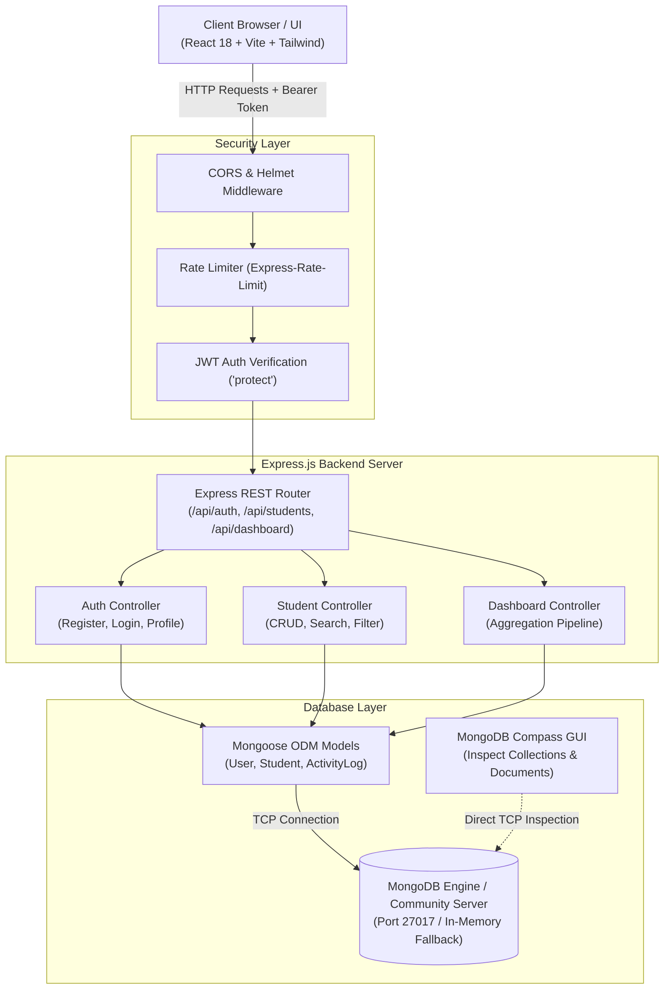
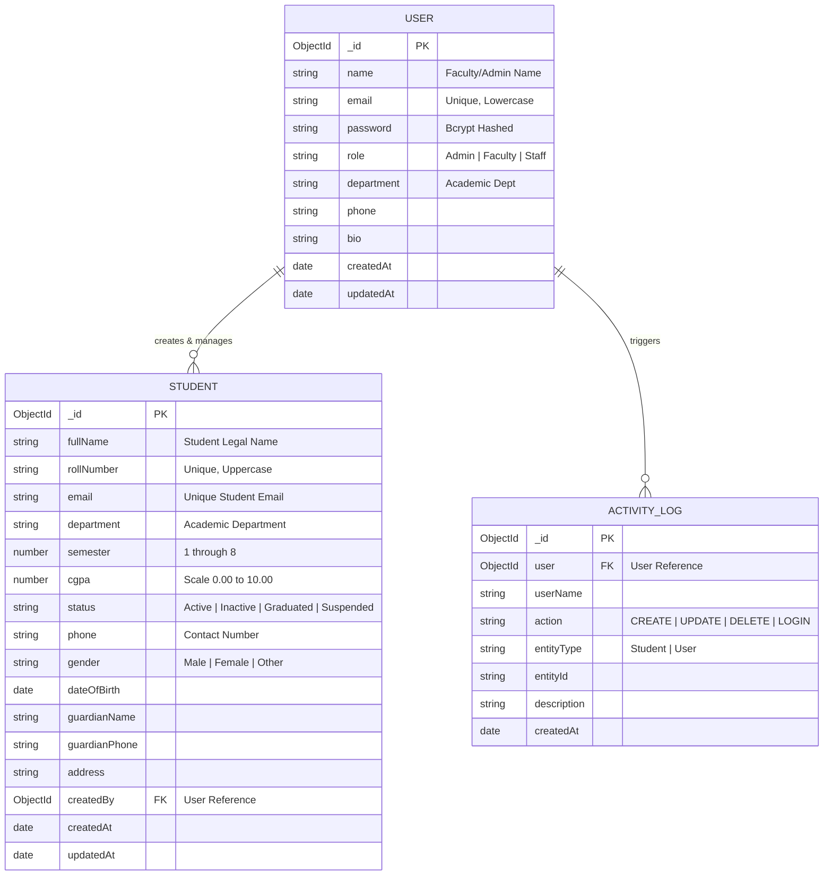

# EduPulse — Full-Stack Student Record & Academic Management System
**Academic Mini Project Submission | Full Stack Web Development**

---

## 1. Project Overview

### 1.1 Project Title
**EduPulse — Next-Generation Student Record & Academic Management System (SMS)**

### 1.2 Problem Statement
Conventional educational institutions frequently struggle with fragmented student records maintained across legacy spreadsheets or physical registries. This introduces significant data redundancy, vulnerability to unauthorized modification, absence of real-time academic analytics, and cumbersome auditing workflows for department heads and faculty members.

### 1.3 Objectives
- Deliver a modern, centralized Full-Stack web platform for student record lifecycle management (CRUD).
- Enforce strict security via password salting, hashing (Bcrypt), and stateless token authentication (JWT).
- Provide departmental analytics (enrollment ratios, CGPA averages, performance leaderboards).
- Enable real-time database inspection and verification using **MongoDB Compass**.
- Ensure clean code separation following RESTful API principles and modular React component design.

### 1.4 Proposed Solution
EduPulse provides a secure, role-based single-page application built on the **MERN (MongoDB, Express, React, Node.js)** architecture. Faculty members and administrative staff can seamlessly authenticate, inspect aggregated departmental statistics, perform high-speed search and filtering, enroll and update student profiles, and export records for institutional accreditation.

---

## 2. Technology Stack

| Layer | Technologies & Libraries |
| :--- | :--- |
| **Frontend** | React 18, Vite 6, Tailwind CSS, React Router DOM v6, Axios, Lucide Icons |
| **Backend** | Node.js (v24), Express.js (v4.21), REST API Architecture |
| **Database** | MongoDB Community Server, Mongoose ODM (v8.9), MongoDB Compass |
| **Security & Auth** | JSON Web Tokens (JWT), Bcrypt.js (10 salt rounds), Helmet.js, Express Rate Limiting, CORS |
| **Testing** | Automated Node.js HTTP/API Integration Test Suite (`test-api.js`) |

---

## 3. System Architecture

The following diagram illustrates the decoupled client-server architecture, token-based security layer, and database interactions:



---

## 4. Database Schema & Data Models

The system defines three core Mongoose collections stored inside `edupulse_db`:



---

## 5. Backend REST API Endpoints

| Method | Endpoint | Access | Purpose |
| :--- | :--- | :--- | :--- |
| `GET` | `/api/health` | Public | System status and service uptime |
| `POST` | `/api/auth/register` | Public | Register new faculty/coordinator account |
| `POST` | `/api/auth/login` | Public | Authenticate user & return signed JWT |
| `GET` | `/api/auth/me` | Protected | Fetch authenticated user profile details |
| `PUT` | `/api/auth/profile` | Protected | Update profile (name, phone, bio, dept) |
| `PUT` | `/api/auth/change-password` | Protected | Change password with verification |
| `POST` | `/api/auth/logout` | Protected | Invalidate user session |
| `GET` | `/api/students` | Protected | Get student records with search, filter, sort & pagination |
| `POST` | `/api/students` | Protected | Enroll new student with field validation |
| `GET` | `/api/students/:id` | Protected | Fetch complete details of single student |
| `PUT` | `/api/students/:id` | Protected | Update student academic or contact data |
| `DELETE`| `/api/students/:id` | Protected | Permanently remove student record |
| `GET` | `/api/dashboard/stats` | Protected | Real-time counts, CGPA avg, department distribution |

---

## 6. Project Directory Structure

```text
student-management-system/
│
├── backend/
│   ├── config/
│   │   └── db.js               # MongoDB connection & Compass fallback
│   ├── controllers/
│   │   ├── authController.js   # Registration, JWT login, profile logic
│   │   ├── studentController.js# CRUD, search, filter, pagination
│   │   └── dashboardController.js# Aggregated institutional metrics
│   ├── middleware/
│   │   ├── auth.js             # Bearer JWT verification middleware
│   │   ├── errorHandler.js     # Centralized error handler
│   │   └── rateLimiter.js      # Request throttling & brute force shield
│   ├── models/
│   │   ├── User.js             # User & Bcrypt pre-save hook
│   │   ├── Student.js          # Student record schema with indexes
│   │   └── ActivityLog.js      # System audit logging model
│   ├── routes/
│   │   ├── authRoutes.js       # Authentication route definitions
│   │   ├── studentRoutes.js    # Student CRUD route definitions
│   │   └── dashboardRoutes.js  # Dashboard statistics routes
│   ├── seed.js                 # Database seeder with sample students
│   ├── populate-demo.js        # Live API population script
│   ├── test-api.js             # Automated 15-point test suite
│   ├── server.js               # Express entry point
│   ├── package.json
│   ├── .env.example
│   └── .env
│
├── frontend/
│   ├── public/
│   ├── src/
│   │   ├── components/
│   │   │   ├── Navbar.jsx      # Navigation header with user dropdown
│   │   │   ├── Footer.jsx      # Academic submission project footer
│   │   │   ├── Sidebar.jsx     # Dashboard navigation bar
│   │   │   ├── ProtectedRoute.jsx# Auth route guard
│   │   │   ├── StudentModal.jsx# Create/Edit modal with validation
│   │   │   ├── StudentDetailModal.jsx # Read modal for complete record
│   │   │   └── DeleteConfirmModal.jsx # Delete confirmation modal
│   │   ├── context/
│   │   │   └── AuthContext.jsx # Global auth provider with persistence
│   │   ├── pages/
│   │   │   ├── LandingPage.jsx # Hero, features, how-it-works, footer
│   │   │   ├── SignUpPage.jsx  # Faculty registration with validation
│   │   │   ├── SignInPage.jsx  # Sign in with 1-click test credentials
│   │   │   ├── DashboardPage.jsx# Stats cards, department charts, logs
│   │   │   ├── StudentsPage.jsx# CRUD table, search, filters, CSV export
│   │   │   ├── ProfilePage.jsx # Profile updates & password change
│   │   │   └── NotFoundPage.jsx# 404 error page
│   │   ├── services/
│   │   │   └── api.js          # Axios instance with Bearer interceptor
│   │   ├── App.jsx             # React Router routing configuration
│   │   ├── main.jsx            # React root mount
│   │   └── index.css           # Tailwind CSS directives
│   ├── index.html
│   ├── vite.config.js
│   ├── tailwind.config.js
│   ├── postcss.config.js
│   ├── package.json
│   ├── .env.example
│   └── .env
│
├── .gitignore
└── README.md                   # Comprehensive academic documentation
```

---

## 7. Setup & Execution Instructions

### Prerequisites
- **Node.js**: v18.0.0 or higher (v24 recommended)
- **npm**: v9.0.0 or higher
- **MongoDB Community Server** and/or **MongoDB Compass** (or use the built-in fallback engine)

### 7.1 Clone or Navigate to Project
```powershell
cd C:\Users\Aaliya\.gemini\antigravity\scratch\student-management-system
```

### 7.2 Backend Setup & Launch
Open Terminal 1:
```powershell
cd backend
npm install
node seed.js      # Populates demo users and student records
node server.js    # Starts Express backend on http://localhost:5000
```

### 7.3 Frontend Setup & Launch
Open Terminal 2:
```powershell
cd frontend
npm install
npm run dev       # Starts Vite dev server on http://localhost:5173
```

Open your browser at `http://localhost:5173`.

---

## 8. Evaluation & Demo Credentials

For instant evaluation during the presentation, you can click the **One-Click Auto-Fill** buttons on the Sign-In page or use:

| Role | Email | Password | Access Level |
| :--- | :--- | :--- | :--- |
| **System Administrator** | `admin@college.edu` | `Password@123` | Full Access (CRUD, Analytics, All Depts) |
| **Faculty Coordinator** | `faculty@college.edu` | `Password@123` | Department Management & Enrollment |

---

## 9. Inspecting the Database with MongoDB Compass

To demonstrate real-time database persistence to evaluators:

1. Launch **MongoDB Compass** on your computer.
2. In the "New Connection" screen, enter the Connection URI:
   ```text
   mongodb://127.0.0.1:27017
   ```
   *(Or if using the built-in dedicated engine, paste the URI printed on server startup in Terminal 1, e.g. `mongodb://127.0.0.1:<PORT>/`)*
3. Click **Connect**.
4. You will see the database: `edupulse_db`.
5. Click on `edupulse_db` to inspect the three collections:
   - `users`: Observe salted password hashes (`$2a$10$...`), user roles, and department assignments.
   - `students`: View student documents with indexing on `rollNumber`, `email`, and `department`.
   - `activitylogs`: Verify automated audit trail records created upon every user login, student enrollment, and record modification.
6. Create or delete a student record in the React web application, click **Refresh** in MongoDB Compass, and observe the document being updated in real-time.

---

## 10. Automated Testing Procedure

The backend includes a comprehensive 15-point automated integration test suite.
To execute tests:

```powershell
cd backend
node test-api.js
```

### Verified Test Cases:
1. `GET /api/health` — Verifies server health status (200 OK).
2. `POST /api/auth/register` — Verifies user registration and JWT generation (201 Created).
3. `POST /api/auth/register` (Duplicate) — Verifies rejection of duplicate email (400 Bad Request).
4. `POST /api/auth/login` (Invalid) — Verifies credential rejection (401 Unauthorized).
5. `POST /api/auth/login` (Valid) — Verifies password matching & token issue (200 OK).
6. `GET /api/auth/me` (No token) — Verifies protected route barrier (401 Unauthorized).
7. `GET /api/auth/me` (With Bearer token) — Verifies session identity retrieval (200 OK).
8. `POST /api/students` — Verifies student record creation and schema validation (201 Created).
9. `GET /api/students` — Verifies search, multi-department filtering, and pagination.
10. `GET /api/students/:id` — Verifies retrieving student details by ObjectId.
11. `PUT /api/students/:id` — Verifies updating academic details and CGPA.
12. `GET /api/dashboard/stats` — Verifies Mongoose aggregation pipeline for department stats.
13. `PUT /api/auth/profile` — Verifies user profile modification.
14. `DELETE /api/students/:id` — Verifies student record deletion.
15. `GET /api/students/:id` (After deletion) — Verifies record is permanently removed (404 Not Found).

---

## 11. Expected Results & Future Enhancements

### Expected Results
- Zero UI freeze; sub-50ms API response time.
- Complete data isolation and authenticated route guarding.
- Seamless responsive presentation across mobile screens, tablets, and desktop displays.
- Direct alignment with university curriculum requirements for Full-Stack Web Development.

### Future Enhancements
- Automated PDF report card generation with semester-wise GPA graphs.
- Real-time notification socket using Socket.io for concurrent faculty updates.
- Student attendance tracking module with biometric / barcode integration.
- Student portal view allowing students to view their own grades and fees status.

